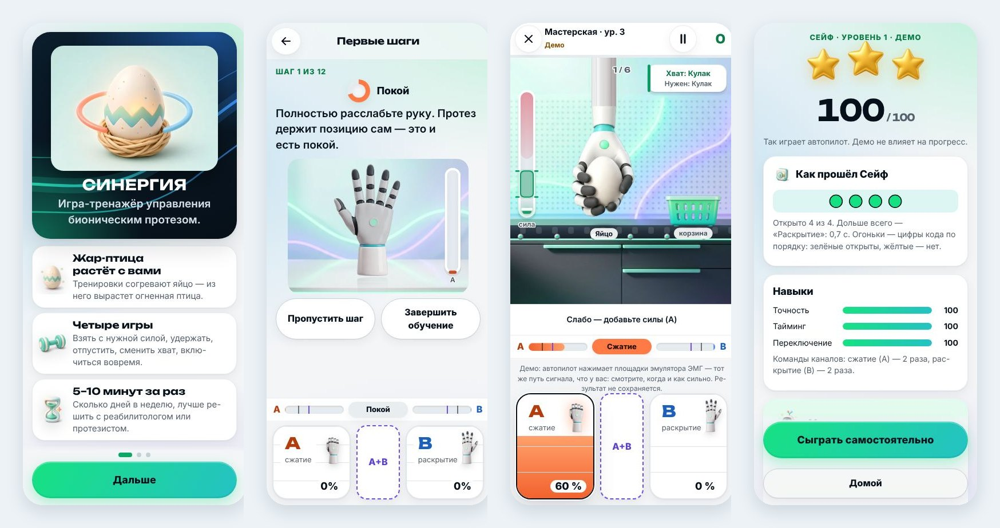
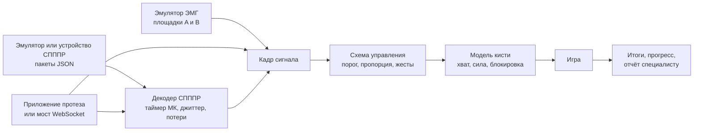

# Синергия

Мобильная игра-тренажёр: учит управлять бионическим протезом кисти через ЭМГ. Решение кейса геймджема «Моторика: Код движения» (задание от 28.10.2026), версия 6.3.4.

- **Что тренирует.** Раздельное сокращение сгибателей и разгибателей, силу и удержание, быстрое переключение, меньше совместных активаций — навыки из задания, каждый со своей механикой и метрикой.
- **Как управляется.** Только сигналами из задания: два канала ЭМГ (Поток 1, пороговый и пропорциональный режимы) или поток СПППР (Поток 2, семь состояний). В играх нет касаний, свайпов и акселерометра.
- **На чём работает.** Android (готовый APK), iPhone и iPad (исходники), браузер (один HTML-файл). Офлайн, без аккаунта. Оба потока — на встроенных эмуляторах: реального протеза в задании нет.

<p align="center"></p>
<p align="center"><sub>Знакомство · обучение «Первые шаги» · «Мастерская» с эмулятором ЭМГ · итоги уровня</sub></p>

## Для жюри

| Что | Где |
|---|---|
| Сборка для Android | [`release/Synergy-6.3.4.apk`](release/Synergy-6.3.4.apk) — [как установить](#как-установить-apk) |
| Та же игра для компьютера | [`release/synergy-standalone.html`](release/synergy-standalone.html) — открыть в браузере, интернет не нужен |
| Демо-видео с комментариями, 2 минуты | [`submission/Synergy-6.3.4-screencast.mp4`](submission/Synergy-6.3.4-screencast.mp4) |
| Где реализовано каждое требование ТЗ | [таблица ниже](#требования-тз-где-сделано), подробно — [`docs/TZ_COMPLIANCE.md`](docs/TZ_COMPLIANCE.md) |
| Техническая документация | [`submission/TECH_DOCS.md`](submission/TECH_DOCS.md), для загрузки — [DOCX](submission/Synergy-6.3.4-tech-docs.docx) |
| Отчёт об использовании ИИ | [`submission/AI_REPORT.md`](submission/AI_REPORT.md), для загрузки — [DOCX](submission/Synergy-6.3.4-ai-report.docx) |
| Исходный код и эмуляторы | этот репозиторий; эмуляторы — [`src/input/`](src/input) и [`tools/spppr-emulator.mjs`](tools/spppr-emulator.mjs) |

## Попробовать за три минуты

1. Поставьте APK на телефон или откройте `release/synergy-standalone.html` на компьютере.
2. «Дальше» → «Дальше» → «Первые шаги». Обучение идёт две минуты: покой, сжатие, раскрытие, сила, смена хвата, блокировка. Его можно пропустить.
3. На главной нажмите «Начать» в «Тренировке дня». Внизу экрана — эмулятор ЭМГ: площадка A сжимает кисть, площадка B раскрывает.
4. Чтобы посмотреть игру без рук, нажмите «Смотреть демо» в любой игре: автопилот сам нажимает площадки эмулятора.

### Чем управлять

| Сигнал | На телефоне | На компьютере |
|---|---|---|
| Канал A — сгибатели, сжать | площадка A; чем выше палец, тем сильнее сигнал | клавиша F |
| Канал B — разгибатели, раскрыть | площадка B | клавиша J |
| A и B вместе — блокировка или смена хвата | кнопка «A+B» | пробел |
| Жесты СПППР: нейтраль и шесть движений | клавиши жестов внизу экрана | цифры 1–7 |

Поток СПППР включается так: «Настройки» → «Управление» → «Жесты». Заполненный прогресс без своих данных: «Настройки» → «Данные» → «Демо-профиль для презентации».

## Как установить APK

Файл: `release/Synergy-6.3.4.apk`, Android 5.0 и новее.

1. Скачайте файл на телефон. В GitLab: ветка `main` → папка `release/` → `Synergy-6.3.4.apk` → «Скачать».
2. Откройте его. Android попросит разрешить установку из этого источника — разрешите.
3. Нажмите «Установить», затем «Открыть». Интернет не нужен.

Если Android пишет «Приложение не установлено», на телефоне стоит «Синергия» с другой подписью: удалите её и поставьте эту. С компьютера то же делает команда:

```bash
adb install -r release/Synergy-6.3.4.apk
```

## Требования ТЗ: где сделано

«Видео» — минута демо-видео, где требование видно. Полная таблица с тестами по каждой строке — [`docs/TZ_COMPLIANCE.md`](docs/TZ_COMPLIANCE.md).

### Поток 1 — два канала ЭМГ

| Требование | Как сделано | Где в коде | Видео |
|---|---|---|---|
| Два канала: сгибатели и разгибатели | канал A закрывает кисть, канал B раскрывает, у каждого свой порог | `src/core/signal.js`, `src/core/hand.js` | 0:24 |
| Пороговый режим: канал 1, канал 2, оба, нет сигнала | сжать; раскрыть; блокировка или смена хвата; кисть держит позу и силу | `src/core/signal.js`, `src/core/fourstates.js` | 0:24 |
| Порог, время удержания, подавление ложных срабатываний, мёртвая зона | ползунки «Параметры сигнала (ТЗ)», у каждого значение по умолчанию | `src/config.js`, `src/ui/settings.js` | 0:24 |
| Пропорциональный режим: сглаживание, ограничение скачков | амплитуда задаёт скорость и силу; экспоненциальное сглаживание, предел скорости изменения | `src/core/signal.js` | — |
| Визуализация активации в игровом формате | полосы A и B с линиями порогов, шкала силы в играх, живой график | `src/ui/widgets.js` | 0:24 |
| Задержка не больше 100 мс | 17 мс при 60 Гц, 33 мс при 30 Гц; настройки показывают отклик на текущих параметрах | `src/core/signal.js`, `tests/stream1.test.mjs` | — |
| Эмулятор двух каналов | площадки A и B на экране, клавиатура | `src/input/emulator.js`, `src/ui/controls.js` | 0:58 |

### Поток 2 — СПППР

| Требование | Как сделано | Где в коде | Видео |
|---|---|---|---|
| Пакет `{timestamp_ms, dist}`, жёсткий контракт | строгий разбор; отклонённый пакет считается и называется по причине | `src/core/spppr.js` | 0:34 |
| Время только по таймеру микроконтроллера | скорость — по разности `timestamp_ms`; часы телефона в расчёт не входят | `src/core/spppr.js` | 0:34 |
| Плавное управление по долям вероятностей | оси джойстика — разности вероятностей (`flexion − extension` и две другие пары) | `src/core/spppr.js`, `src/core/joystick.js` | 0:34 |
| Jitter от 10 до 100+ мс | между пакетами движение продолжается по наклону, без рывков | `src/core/spppr.js` | 0:46 |
| Потеря пакетов дольше 200 мс | скорость плавно гаснет, игра не зависает; через 1,5 с тишины — пауза «Сигнал потерян» | `src/core/spppr.js` | — |
| Ошибки классификации | команда приходит с первым пакетом, одиночный ошибочный пакет откатывается следующим | `src/core/spppr.js` | 0:46 |
| Эмулятор JSON-потока с ошибками, потерями и джиттером | в игре и отдельной программой; 10 или 50 Гц | `src/input/spppr-emulator.js`, `tools/spppr-emulator.mjs` | 0:34 |
| Замена эмулятора на драйвер одной строкой | эмулятор и драйверы отдают один и тот же пакет | `src/input/spppr-driver.js` | — |

### Обучение, мотивация, интерфейс

| Требование | Как сделано | Где в коде | Видео |
|---|---|---|---|
| Режим обучения в начале | «Первые шаги»: 12 шагов с живой подсказкой и картинкой кисти | `src/core/tutorial.js` | 0:11 |
| Минимум три уровня | 8–10 уровней в каждой из шести игр | `src/games/` | 0:58 |
| Навыки: изоляция, меньше коактиваций, сила, удержание, реакция | у каждого навыка своя механика и своя метрика в итогах | `src/games/`, `src/core/analytics.js` | 1:25 |
| Прогрессия и адаптация сложности | допуски сужаются и расширяются по ходу игры; план дня собирается по слабым навыкам | `src/core/adaptive.js`, `src/core/progress.js` | 0:05 |
| Очки, уровни, достижения, обратная связь | очки 0–100, звёзды, опыт, 15 достижений, итоги с навыками | `src/core/progress.js`, `src/ui/results.js` | 1:25 |
| 1–3 миссии на сессию из пула не меньше 10 | 16 типов миссий | `src/core/quests.js` | 0:05 |
| 60–80 % времени — игра с таймингом | доля считается и видна в отчёте; отдых между упражнениями — отдельно | `src/core/timeshare.js` | 1:44 |
| Учёт ошибок, утомляемости, привыкания | подсказки в моменте, опрос самочувствия, мягкий лимит 30 минут в день | `src/core/wellbeing.js` | — |
| Оформление и звук | единый стиль, 244 иллюстрации; звук и музыка «Ритма» создаются кодом | `public/art/`, `src/services/audio.js` | 0:46 |
| Простой интерфейс без мультитача и свайпов | в играх — только сигнал; меню можно пройти без касаний, удержанием канала A | `src/core/handsfree.js` | 1:52 |
| Основной сценарий от начала до конца | план дня; каждый уровень проходят автопилот и модель новичка | `tests/games.test.mjs` | 0:58 |
| Сбор обратной связи | «Отзыв о тестировании»: анкеты SUS и NASA-TLX, выгрузка JSON и CSV | `src/core/survey.js` | — |
| Встраивание и документация интеграции | запуск ссылкой или интентом, обмен данными, примеры хостов | [`docs/INTEGRATION.md`](docs/INTEGRATION.md), [`docs/embed/README.md`](docs/embed/README.md) | — |

## Игры

| Игра | Что делать | Что тренирует | Уровней |
|---|---|---|---|
| «Мастерская» | взять предмет с нужной силой, перенести, отпустить в корзину; сменить хват | силу, изоляцию, удержание | 10 |
| «Полёт» | провести планер через кольца: высота — это сила сигнала | плавность и удержание уровня | 8 |
| «Ритм» | сжимать и раскрывать в такт музыке | тайминг и переключение | 8 |
| «Сейф» | набрать код последовательностью команд | переключение, покой между командами | 8 |
| «Созвездие» | довести искру до звезды и замереть: джойстик из жестов СПППР | управление по вероятностям | 8 |
| «Две руки» | одной рукой сжать, другой удержать покой — для двух протезов | раздельную работу рук | 8 |

Вокруг игр: обучение «Первые шаги», план дня на 5–10 минут, миссии сессии, еженедельная «Проверка навыка» без подсказок, питомец Жар-птица (или режим «Только цифры»), отчёт для специалиста и «Азбука протеза».

## Что подтвердили эксперты «Моторики»

Мы дважды отправляли вопросы экспертам и перестраивали игру под ответы.

| Вопрос | Ответ экспертов | Как в игре |
|---|---|---|
| Как ведёт себя кисть в пороговом режиме | закрывается с постоянной скоростью, без сигнала держит позу и силу, сигнал раскрытия сразу открывает | так работает модель кисти |
| С какой схемы начинать новичку | с пороговой; оба канала выше порога — выполняется первая команда | пороговая схема и «Первая команда» по умолчанию |
| Ждать ли второго пакета СПППР | важнее быстрая реакция | команда с первого пакета, ошибочный откатывается |
| Вероятность СПППР — это сила? | нет: сила набирается временем удержания, уверенность влияет на скорость | так и сделано |
| «2 жеста + нейтраль» — какие жесты | любые два | пара выбирается в настройках |
| Отдых и доля 60–80 % | паузы для отдыха считаются отдельно; когда отдыхать, решает человек | отдых не входит в долю; игра советует, но не останавливает |
| Мотивация для взрослых | им интереснее цифры | режим «Только цифры» |
| Как встраивать | роутингом: запуск и обмен данными | запуск ссылкой или интентом со стороной руки и порогами |

## Сборка и проверка

Нужен Node.js 22 или новее.

```bash
npm ci
```

```bash
npm start
```

Игра откроется на http://127.0.0.1:8080. Офлайн-сборка и APK собираются без Android Studio и Android SDK (нужен JDK 11 или новее):

```bash
npm run build
```

```bash
sh tools/build-apk.sh
```

Проверки:

```bash
npm test
```

```bash
npm run test:tz
```

```bash
npm run e2e:a11y
```

```bash
npm run audit:layout
```

`npm test` — модульные тесты и прохождение всех уровней; `test:tz` — все уровни на потоке СПППР с джиттером и потерями; `e2e:a11y` — экраны в браузере и доступность (axe-core); `audit:layout` — раскладка на восьми размерах экрана.

Результаты этой сборки:

<!-- evidence:begin -->
| Главное | Цифра | Где проверить |
|---|---|---|
| Тесты | 624 теста, 0 упали | `npm test` |
| Доступность | 0 нарушений axe: светлая тема — 39 состояний, тёмная — 10 (10.11.2026) | `npm run e2e:a11y` |
| Раскладка | 83 состояния × 8 экранов × текст 100/130/200 % = 1992 — 4 находки (10.11.2026) | `npm run audit:layout` |
| Контраст | каждая пара цветов ≥ 4,5:1 в трёх темах | `tests/design.test.mjs` |
| Графика | 244 иллюстрации, 4,30 МБ, у каждой есть место на экране | `docs/ART.md`, `tests/v516.test.mjs` |
| Офлайн | APK 5109 КБ, HTML 6,56 МБ, без сети и аккаунта | `release/`, `docs/evidence.json` |
<!-- evidence:end -->

## Как устроено



Игра написана на JavaScript без фреймворков: один и тот же код работает в APK (оболочка WebView), в приложении iPhone (SwiftUI и WKWebView), в браузере и внутри чужого приложения. Данные хранятся только на устройстве.

| Папка | Что внутри |
|---|---|
| `src/core` | сигнал, модель кисти, декодер СПППР, калибровка, прогресс |
| `src/input` | эмуляторы, драйверы устройства, мост |
| `src/games` | игры и проверка навыка |
| `src/ui`, `src/render` | экраны, площадки эмулятора, отрисовка |
| `android/`, `ios/` | оболочки для телефонов |
| `bridge/` | мост на Python для внешнего эмулятора, датчиков или протеза |
| `tests/`, `tools/` | тесты, сборка, проверки |

## Ограничения

- Это прототип геймджема, а не медицинское изделие. Игра не ставит диагнозов и не назначает лечения.
- Реального протеза и реального потока СПППР в задании нет: оба потока проверены на эмуляторах и в тестах.
- Перенос навыка из игры на протез не измерялся. Метрики игры — игровые, не клинические.
- На самом маленьком экране в альбомной ориентации (568 × 320) площадки эмулятора в игре выходят за нижний край — 4 находки линтера раскладки. В портретной ориентации и на остальных размерах находок нет.
- APK подписан отладочным ключом. Приложение iPhone не собиралось в Xcode.
- На экранном эмуляторе без ЭМГ, по словам экспертов, тренировка пользы не даёт. Эмулятор нужен, чтобы посмотреть игры и проверить управление.

Подробно — [`LIMITS.md`](LIMITS.md).

## Документы

| Документ | О чём |
|---|---|
| [`docs/TZ_COMPLIANCE.md`](docs/TZ_COMPLIANCE.md) | каждое требование задания: решение, файл, проверка |
| [`submission/TECH_DOCS.md`](submission/TECH_DOCS.md) | установка, запуск, использование, проверка |
| [`submission/AI_REPORT.md`](submission/AI_REPORT.md) | где использован ИИ и как проверен результат |
| [`docs/ARCHITECTURE.md`](docs/ARCHITECTURE.md) | путь сигнала, слои, правила кода |
| [`docs/INTEGRATION.md`](docs/INTEGRATION.md) | форматы данных, подключение датчиков и протеза |
| [`docs/embed/README.md`](docs/embed/README.md) | встраивание в приложение, примеры хостов |
| [`docs/GAME_RULES.md`](docs/GAME_RULES.md) | правила игр, очки, параметры |
| [`docs/ACCESSIBILITY.md`](docs/ACCESSIBILITY.md) | доступность |
| [`LIMITS.md`](LIMITS.md) | чего игра не делает |

Авторы — [`AUTHORS.md`](AUTHORS.md). © 2026 команда SYNERGY — [`LICENSE`](LICENSE). Шрифты и сторонние компоненты — [`THIRD_PARTY.md`](THIRD_PARTY.md).
