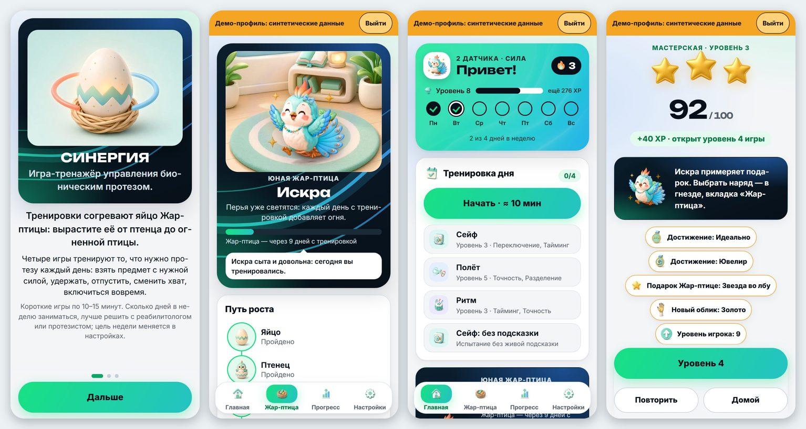
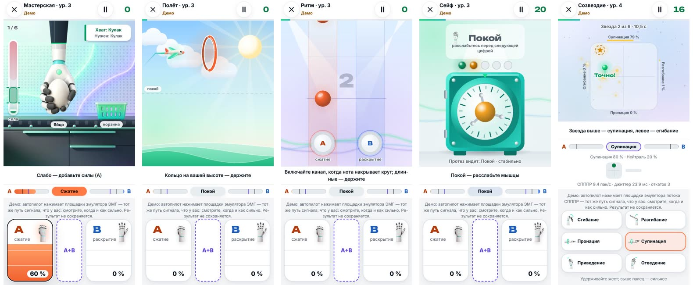
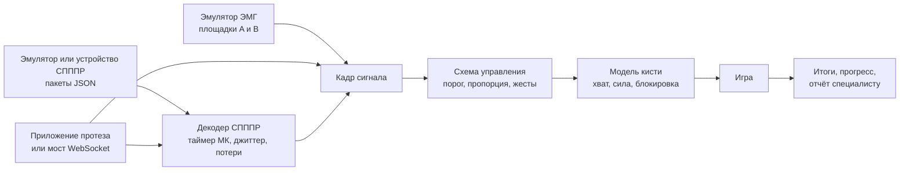

<p align="center">
  
  
  
  
  
</p>

# Синергия

Игра-тренажёр для людей, которые учатся управлять бионическим протезом кисти.

**Зачем.** С новым протезом человек заново учится тому, что раньше делал не думая: напрячь одну мышцу и не задеть соседнюю, сжать стаканчик ровно с той силой, какая нужна, удержать и вовремя отпустить. Тренироваться с самим протезом утомительно и скучно, поэтому тренировки бросают.

**Что делает.** Превращает эти навыки в короткие игры, где управление устроено так же, как у протеза. Сгибатели закрывают кисть, разгибатели раскрывают, кисть сама держит позу и силу, пока сигнала нет. Играть можно только сигналами из задания: двумя каналами ЭМГ или потоком системы распознавания паттернов (СПППР). Касаний, свайпов и акселерометра в играх нет.

**Что готово.** Полная игра для геймджема «Моторика: Код движения» по заданию от 28.10.2026: шесть игр, обучение, оба потока управления из ТЗ, сборки для Android, iPhone и браузера. Оба потока работают на встроенных эмуляторах, как требует задание; драйвер реального устройства ставится вместо эмулятора без правок игры. Игра — тренажёр, а не медицинское изделие.

<p align="center"></p>
<p align="center"><sub>Знакомство · гнездо Жар-птицы · главная с планом дня · итоги упражнения</sub></p>

## Для жюри

| Что | Где |
|---|---|
| Сборка для Android | [`release/Synergy-6.3.3.apk`](release/Synergy-6.3.3.apk) — [как установить](#как-установить-apk) |
| Та же игра для компьютера, одним файлом | [`release/synergy-standalone.html`](release/synergy-standalone.html) — открыть в браузере, интернет не нужен |
| Где в коде каждое требование ТЗ | [таблица ниже](#требования-тз-где-сделано) и подробно — [`docs/TZ_COMPLIANCE.md`](docs/TZ_COMPLIANCE.md) |
| Видео прохождения | загружено на платформу; главы и минуты — в [таблице требований](#требования-тз-где-сделано) |
| Техническая документация | [`submission/TECH_DOCS.md`](submission/TECH_DOCS.md), архитектура и интеграция — в [`docs/`](docs) |
| Отчёт об использовании ИИ | [`submission/AI_REPORT.md`](submission/AI_REPORT.md) |
| Исходный код с эмуляторами | весь репозиторий; эмуляторы — [`src/input/`](src/input) и [`tools/spppr-emulator.mjs`](tools/spppr-emulator.mjs) |

## Содержание

- [Попробовать за три минуты](#попробовать-за-три-минуты)
- [Как установить APK](#как-установить-apk)
- [Чему учит игра](#чему-учит-игра)
- [Игры](#игры)
- [Управление: два потока из задания](#управление-два-потока-из-задания)
- [Требования ТЗ: где сделано](#требования-тз-где-сделано)
- [Мотивация и безопасность](#мотивация-и-безопасность)
- [Интерфейс и доступность](#интерфейс-и-доступность)
- [Встраивание в приложение протеза](#встраивание-в-приложение-протеза)
- [Что подтвердили эксперты «Моторики»](#что-подтвердили-эксперты-моторики)
- [Как устроено](#как-устроено)
- [Сборка и проверка](#сборка-и-проверка)
- [Границы проекта](#границы-проекта)
- [Документы](#документы)

## Попробовать за три минуты

1. Поставьте APK на телефон или откройте `release/synergy-standalone.html` на компьютере.
2. «Дальше» → «Дальше» → «Первые шаги». Обучение занимает две минуты: покой, сжатие, раскрытие, сила, смена хвата, блокировка — каждый шаг с живой подсказкой. Можно нажать «Пропустить обучение».
3. На главной откройте «Тренировку дня» и нажмите «Начать». Внизу экрана — эмулятор ЭМГ. Держите площадку A, чтобы сжать кисть, площадку B — чтобы раскрыть. Чем выше палец на площадке, тем сильнее сигнал. На компьютере те же площадки на клавишах F и J.
4. Поток СПППР: «Настройки» → «Управление» → «Жесты». Внизу появятся клавиши жестов: нейтраль и шесть движений из задания, на компьютере — цифры 1–7.
5. Заполненный прогресс без своих данных: «Настройки» → «Данные» → «Демо-профиль для презентации». В любой игре есть «Смотреть демо»: автопилот нажимает площадки эмулятора, и видно, когда сжимать и когда раскрывать.

## Как установить APK

Готовая сборка лежит в репозитории: `release/Synergy-6.3.3.apk`, Android 5.0 и новее.

1. Скачайте файл. В GitLab: ветка `main` → папка `release/` → `Synergy-6.3.3.apk` → «Скачать». Файл можно скачать прямо на телефон или передать с компьютера по USB или в мессенджере.
2. Откройте его на телефоне. Android попросит разрешить установку из этого источника — браузера или файлового менеджера. Разрешите. На старых версиях это «Настройки» → «Безопасность» → «Неизвестные источники».
3. Нажмите «Установить», затем «Открыть». Интернет не нужен. Приложение просит два обычных разрешения: вибрацию и сеть. Сеть нужна, только если подключать внешний эмулятор или датчики.
4. Если Android пишет «Приложение не установлено», на телефоне уже стоит «Синергия» с другой подписью. Сохраните прогресс («Настройки» → «Данные» → «Сохранить копию»), удалите старую версию и поставьте эту.

С компьютера то же самое делает команда `adb install -r release/Synergy-6.3.3.apk`, если на телефоне включена отладка по USB.

## Чему учит игра

Задание называет навыки, которые нужны протезу. Каждый из них тренирует своя механика и меряет своя метрика.

| Навык из задания | Как его тренирует игра | Что видит человек |
|---|---|---|
| Изолированное сокращение антагонистов | в «Мастерской» и «Ритме» нужна одна мышца, лишнее включение второй — ошибка | навык «Разделение», строка «второй канал включался» в итогах |
| Меньше совместных активаций | одновременное напряжение A и B — отдельная команда: блокировка или смена хвата. Случайная коактивация срывает действие | счётчик коактиваций в итогах и в отчёте |
| Контроль силы | предмет нужно взять в зелёной зоне силы: яйцо раздавится, губка выскользнет. В «Полёте» высота — это сила сигнала | навык «Точность» |
| Длительность и удержание | удержать силу в зоне, удержать высоту между кольцами | навык «Плавность» |
| Скорость реакции и переключение | «Ритм»: сжатие и раскрытие точно в долю; «Сейф»: код из серии команд | навыки «Тайминг» и «Переключение» |
| Связь «мышца — действие» | закон управления тот же, что у протеза, и картинка кисти повторяет каждую команду | кисть на экране |
| Меньше нагрузки на внимание | подсказки затухают, раз в неделю — проверка навыка без подсказок | навык «Без подсказки», неделя к неделе |

Сложность подстраивается под человека: допуски сужаются и расширяются по ходу упражнения, а план дня каждый день собирает упражнения по самым слабым навыкам.

## Игры

| Игра | Что делать | Уровней |
|---|---|---|
| «Мастерская» | взять предмет с конвейера с нужной силой, перенести и отпустить в корзину; сменить хват для монеты и ключа | 10 |
| «Полёт» | провести планер через кольца: высота равна силе сигнала | 8 |
| «Ритм» | сжимать и раскрывать в такт музыке | 8 |
| «Сейф» | набрать код последовательностью команд | 8 |
| «Созвездие» | довести искру до звезды и замереть в ней: джойстик из движений СПППР | 8 |
| «Две руки» | одной рукой сжать, другой удержать покой — для двух протезов | 8 |
| «Первые шаги» | обучение: 12 шагов с подсказкой и картинкой кисти | — |
| «Проверка навыка» | раз в неделю, без подсказок: прогресс неделя к неделе | — |

<p align="center"></p>
<p align="center"><sub>«Мастерская» · «Полёт» · «Ритм» · «Сейф» · «Созвездие». Под игрой — эмулятор: площадки ЭМГ или клавиши жестов СПППР</sub></p>

Ещё есть «Азбука протеза» — короткие карточки о жизни с протезом с проверкой себя в конце.

## Управление: два потока из задания

### Поток 1 — два канала ЭМГ

Канал A — сгибатели, закрывает кисть. Канал B — разгибатели, раскрывает. Каждому каналу свой порог.

- **Пороговый режим.** A — сжать, B — раскрыть, A и B вместе — блокировка или смена хвата, нет сигнала — кисть держит позу и силу. Кисть закрывается с постоянной скоростью, сила растёт, пока держится сигнал. По умолчанию стоит этот режим: так управляются серийные протезы.
- **Пропорциональный режим.** Амплитуда задаёт скорость и силу. Сигнал сглаживается, резкие скачки ограничены, уровень активации виден полосами A и B с линиями порогов.
- **Параметры из задания** в «Настройки» → «Параметры сигнала (ТЗ)»: порог, время удержания, подавление ложных срабатываний, мёртвая зона. У каждого есть значение по умолчанию.

Отклик — следующий кадр сигнала: 17 мс при 60 Гц и 33 мс при 30 Гц. В задании предел 100 мс.

### Поток 2 — СПППР

Игра принимает пакеты ровно в формате задания:

```json
{ "timestamp_ms": 1720000000123,
  "dist": { "neutral": 0.05, "flexion": 0.65, "extension": 0.15, "pronation": 0.05,
            "supination": 0.05, "adduction": 0.03, "abduction": 0.02 } }
```

- **Время** считается только по `timestamp_ms` — таймеру микроконтроллера. Часы телефона в расчёт скорости не входят.
- **Вероятности** дают плавное управление: оси джойстика — разности `flexion − extension`, `pronation − supination`, `abduction − adduction`. Сила хвата набирается временем удержания жеста, а чёткость жеста влияет на скорость.
- **Джиттер** от 10 до 100+ мс сглаживается: между пакетами движение продолжается по наклону, без рывков.
- **Потеря пакетов.** Через 200 мс без пакета скорость гаснет, игра не зависает. Через 1,5 с тишины — пауза «Сигнал потерян».
- **Ошибки классификации.** Команда приходит с первым же пакетом, а одиночный ошибочный пакет откатывается следующим. Отпустить предмет или засчитать ноту может только команда, подтверждённая вторым пакетом.
- **Словари.** Семь состояний из задания и вариант «2 жеста + нейтраль». Пару жестов для него выбирают в настройках: любые два из шести движений.

### Эмуляторы

| Что | Где |
|---|---|
| ЭМГ на экране: площадки A и B, клавиши F, J и пробел | `src/input/emulator.js`, `src/ui/controls.js` |
| Поток СПППР в формате задания: 10 или 50 Гц, джиттер, потери, обрывы, ошибочные пакеты, перезапуск микроконтроллера | `src/input/spppr-emulator.js` |
| Тот же поток программой, для внешних проверок | `node tools/spppr-emulator.mjs --help` |
| Мост для внешнего эмулятора, датчиков или протеза | `bridge/ws_bridge.py` (Python 3.9+, без зависимостей) |

Драйвер настоящего устройства ставится вместо эмулятора без правок остального кода: оба отдают один и тот же пакет (`src/input/spppr-drivers.js` — WebSocket, Web Serial, Bluetooth).

## Требования ТЗ: где сделано

Полная таблица с проверками — [`docs/TZ_COMPLIANCE.md`](docs/TZ_COMPLIANCE.md). Минута — глава видео, где это видно.

| Требование | Как сделано | Где в коде | Видео |
|---|---|---|---|
| Два канала: сгибатели и разгибатели | A закрывает кисть, B раскрывает, у каждого свой порог | `src/core/signal.js`, `src/core/hand.js` | 0:24 |
| Пороговый режим: 1, 2, 1+2, нет сигнала | сжать, раскрыть, блокировка или смена хвата, кисть держит позу | `src/core/signal.js`, `src/core/hand.js` | 0:24 |
| Порог, время удержания, подавление ложных срабатываний, мёртвая зона | ползунки «Параметры сигнала (ТЗ)», значения по умолчанию | `src/config.js`, `src/ui/settings.js` | 0:24 |
| Пропорциональный режим: сглаживание, ограничение скачков, визуализация | скорость и сила от амплитуды, полосы A и B с порогами, живой график | `src/core/signal.js`, `src/ui/widgets.js` | 0:24 |
| Задержка не больше 100 мс | 17 мс при 60 Гц, 33 мс при 30 Гц | `tests/v530.test.mjs` | — |
| Пакет `{timestamp_ms, dist}`, жёсткий контракт | строгий разбор, отклонённые пакеты считаются | `src/core/spppr.js` | 0:34 |
| Delta time только по таймеру МК | скорость — по разности `timestamp_ms` | `src/core/spppr.js` | 0:34 |
| Плавное управление по долям вероятностей | оси из разностей вероятностей, мёртвая зона, сглаживание | `src/core/spppr.js`, `src/core/joystick.js` | 0:34 |
| Jitter, потери больше 200 мс, ошибки классификации | экстраполяция, затухание скорости, откат одиночного пакета | `src/core/spppr.js` | 0:46 |
| Эмулятор JSON-потока с ошибками, потерями и джиттером | профиль потока 10 и 50 Гц, программа-эмулятор | `src/input/spppr-emulator.js`, `tools/spppr-emulator.mjs` | 0:34 |
| Навыки: изоляция, коактивации, сила, длительность, реакция | механики и метрики шести игр | `src/games/`, `src/core/analytics.js` | 0:58 |
| Минимум 3 уровня и обучение в начале | 8–10 уровней в каждой игре, «Первые шаги» | `src/games/registry.js`, `src/core/tutorial.js` | 0:11 |
| Прогрессия и адаптация сложности | адаптивные допуски, план дня по слабым навыкам | `src/core/adaptive.js`, `src/core/progress.js` | 0:58 |
| Очки, уровни, достижения, обратная связь | очки 0–100, звёзды, опыт, 15 достижений, итоги с навыками | `src/core/progress.js`, `src/ui/results.js` | 1:25 |
| 1–3 миссии из пула не меньше 10 | 16 типов миссий, 1–3 на сессию | `src/core/quests.js` | 0:05 |
| 60–80 % времени — игра с таймингом | доля считается, отдых между упражнениями отдельно | `src/core/timeshare.js` | 1:44 |
| Красочное оформление и звук | единый стиль, 244 иллюстрации, музыка «Ритма» генерируется кодом | `public/art/`, `src/services/music.js` | 0:46 |
| Обратная связь, ошибки, утомляемость | подсказки в моменте, опрос самочувствия, мягкий лимит 30 минут в день | `src/core/wellbeing.js`, `src/ui/checkin.js` | 1:35 |
| Простой интерфейс без мультитача и свайпов | в играх только сигнал; меню можно пройти без касаний, удержанием A | `src/core/handsfree.js` | 1:52 |
| Пройти игру от начала до конца | план дня, все уровни проходит автопилот и модель новичка | `tests/games.test.mjs` | 0:58 |
| Сбор обратной связи | «Отзыв о тестировании»: SUS, NASA-TLX, вопросы об игре, выгрузка JSON и CSV | `src/core/survey.js` | — |
| Встраивание и документация | запуск ссылкой или интентом, обмен данными, примеры хостов | `docs/INTEGRATION.md`, `docs/embed/README.md` | — |

## Мотивация и безопасность

- **Очки и уровни.** У каждого упражнения очки от 0 до 100 и до трёх звёзд, у игрока — опыт и уровень, 15 достижений.
- **Миссии сессии.** Каждый заход — одна-три цели из 16 типов, подобранные по слабым навыкам. Цель недели можно взять или отказаться без штрафа.
- **Жар-птица** растёт от дней с тренировкой, а не от очков. Пропуск и отдых ничего не отнимают. Кому ближе цифры, выбирает «Только цифры»: вместо птицы — дни, минуты и упражнения.
- **Сессия 5–10 минут.** План дня — три упражнения с отдыхом между ними. Через 30 минут в день игра мягко предлагает закончить, ребёнку — через 20.
- **Самочувствие.** Перед планом дня — короткий опрос о боли, усталости и коже. Заболело посреди игры: «Пауза» → «Стало больно — закончить на сегодня».

## Интерфейс и доступность

Светлая и тёмная темы, высокий контраст, текст до 200 %, любая ориентация экрана. Озвучивание подсказок, вибро-метроном в «Ритме», «Меньше движения». Площадки без удержания — для тремора и слабости. Кнопки на экране можно перенести под здоровую руку. Детский режим закрывает настройки PIN-кодом родителя.

Экраны игры проверяет axe-core по правилам WCAG 2.2 A/AA, раскладку — линтер на восьми размерах экрана и трёх размерах текста. Результаты — в таблице [проверки](#сборка-и-проверка).

## Встраивание в приложение протеза

Приложение протеза запускает игру и обменивается с ней данными — так встраивание описали организаторы.

- **Запуск.** Android — интентом или ссылкой `synergy://play?game=grip&level=2&side=left&closeThreshold=60&openThreshold=45`, iPhone — той же ссылкой, веб — адресом с теми же параметрами. Передаются сторона руки, пороги протеза, набор жестов и пара «2 жестов».
- **Данные.** Поток двух датчиков ЭМГ или пакеты СПППР — через `postMessage`, `window.Synergy.feed()`, нативный мост Android или WebSocket. Снимок сигнала Motorica Start (два уровня 0…255) читается без переделки.
- **Ответ.** После упражнения игра присылает итог: очки, звёзды, навыки, пороги. Данные о самочувствии наружу не уходят.

Примеры хостов на Kotlin, Swift, Flutter, React Native, Unity и для веба — [`docs/embed/README.md`](docs/embed/README.md). Протокол целиком — [`docs/INTEGRATION.md`](docs/INTEGRATION.md).

## Что подтвердили эксперты «Моторики»

По ходу геймджема мы дважды отправляли вопросы экспертам и перестраивали игру под ответы.

| Вопрос | Ответ экспертов | Как в игре |
|---|---|---|
| Как ведёт себя кисть в пороговом режиме | закрывается с постоянной скоростью, без сигнала держит позу и силу, сигнал раскрытия сразу открывает | так работает модель кисти |
| С какой схемы начинать новичку | с пороговой; если оба канала выше порога — выполняется первая команда | пороговая схема и «Первая команда» по умолчанию |
| Ждать ли подтверждения пакета СПППР | важнее быстрая реакция | команда с первого пакета, ошибочный откатывается |
| Вероятность СПППР — это сила? | нет: сила набирается временем удержания, уверенность влияет на скорость | так и сделано |
| «2 жеста + нейтраль» — какие жесты | любые два | пара выбирается в настройках |
| Кто решает, когда отдыхать | сам человек; паузы не входят в долю 60–80 % | игра не останавливает по падению сигнала, отдых считается отдельно |
| Мотивация для взрослых | им интереснее цифры | режим «Только цифры» |
| Нужна ли тренировка без ЭМГ | нет, тренируются на сигнале протеза | игра рассчитана на сигнал протеза; эмулятор — для демонстрации и отладки, как в ТЗ |

### Слабые места прошлых игр — и как они закрыты

Организаторы назвали недостатки предыдущих проектов (общая Q&A-сессия, ответ 30). Мы проектировали игру от этого списка.

| Что мешало прошлым играм | Как сделано в «Синергии» |
|---|---|
| Мало реиграбельности | план дня каждый день собирается заново по самым слабым навыкам; 50 уровней в шести играх; 16 типов миссий; раз в неделю — проверка навыка; новые коды, кольца и ноты в каждом раунде |
| Большой размер | APK около 5 МБ при ориентире организаторов 100–150 МБ; работает офлайн |
| Слабая подстройка под экраны | восемь размеров экрана от 320 px до ноутбука, портрет и альбом, текст до 200 % — линтер раскладки без находок |
| Незавершённый сюжет | обучение, план дня и все уровни проходятся от начала до конца; это проверяет автопилот на каждом уровне |
| Дисбаланс каналов ЭМГ | игра считает команды каналов A и B в каждом упражнении и показывает перекос; уровни выровнены по обоим каналам |
| Однообразие механик | шесть разных механик: сила хвата, высота полёта, ритм, код из команд, джойстик жестов, две руки |

Все ответы организаторов и экспертов с тем, что по каждому сделано, — в [`docs/TASK.md`](docs/TASK.md).

## Как устроено



Игра написана на JavaScript без фреймворков и работает одинаково в APK, в приложении iPhone, в браузере и внутри чужого приложения. Android-оболочка — WebView, iPhone — SwiftUI и WKWebView. Рисование — Canvas 2D, звук и музыка — Web Audio, данные хранятся только на устройстве.

| Папка | Что внутри |
|---|---|
| `src/core` | сигнал, модель кисти, декодер СПППР, калибровка, прогресс, самочувствие |
| `src/input` | эмуляторы, драйверы микроконтроллера, мост, Bluetooth |
| `src/games` | игры, проверка навыка, исполнитель шага игры |
| `src/ui`, `src/render` | экраны, площадки эмулятора, отрисовка |
| `android/`, `ios/` | оболочки для телефонов |
| `bridge/`, `lab/` | мост на Python, лаборатория сырой ЭМГ |
| `tests/`, `tools/` | тесты, сборка, проверки, скринкаст |

Подробно — [`docs/ARCHITECTURE.md`](docs/ARCHITECTURE.md).

## Сборка и проверка

Нужен Node.js 22 или новее.

```bash
npm ci
```

```bash
npm start
```

Игра откроется на http://127.0.0.1:8080. Офлайн-сборка и APK — без Android Studio и Android SDK:

```bash
npm run build
```

```bash
VERIFY_API=1 sh tools/build-apk.sh
```

Проверки:

```bash
npm test                 # модульные тесты, прохождение всех уровней автопилотом и моделью новичка
npm run test:tz          # поток СПППР: все уровни четырёх игр на 10 и 50 Гц, оба словаря
npm run e2e:a11y         # экраны без ошибок, axe-core без нарушений
npm run audit:layout     # раскладка на восьми экранах и трёх размерах текста
```

Последний прогон этой сборки:

<!-- evidence:begin -->
| Главное | Цифра | Где проверить |
|---|---|---|
| Тесты | 610 тестов, 0 упали | `npm test` |
| Доступность | 0 нарушений axe: светлая тема — 37 состояний, тёмная — 10 (09.11.2026) | `npm run e2e:a11y` |
| Раскладка | 81 состояние × 8 экранов × текст 100/130/200 % = 1944 — 0 находок (09.11.2026) | `npm run audit:layout` |
| Контраст | каждая пара цветов ≥ 4,5:1 в трёх темах | `tests/design.test.mjs` |
| Графика | 244 иллюстрации, 4,30 МБ, у каждой есть место на экране | `docs/ART.md`, `tests/v516.test.mjs` |
| Офлайн | APK 5108 КБ, HTML 6,55 МБ, без сети и аккаунта | `release/`, `docs/evidence.json` |
<!-- evidence:end -->

## Границы проекта

- **Тренажёр, а не медицинское изделие.** Игра учит управлению и показывает прогресс; диагнозы и лечение — дело специалиста, и игра к нему отправляет.
- **Эмуляторы — по заданию.** ТЗ даёт на геймджем только эмуляторы, поэтому оба потока отлажены на них и закрыты тестами: каждый уровень каждой игры проходится на потоке с джиттером, потерями и ошибками распознавания. Контракт данных жёсткий, и реальное устройство подключается вместо эмулятора.
- **Следующий шаг — пилот с пользователями протезов.** Метрики игры готовы к нему: отчёт специалиста, недельная проверка навыка, выгрузка данных. Перенос навыка на протез измеряется в пилоте, а не в геймджеме.
- **Сборки.** APK собран и лежит в `release/`, подпись отладочная — для раздачи в магазине нужен ключ компании. Приложение iPhone — исходный код на SwiftUI с инструкцией сборки на Mac.
- **Игра рассчитана на сигнал протеза.** Экранный эмулятор — для демонстрации и отладки: эксперты подтвердили, что тренировать мышцы нужно на настоящей ЭМГ.

Подробно — [`LIMITS.md`](LIMITS.md).

## Документы

| Документ | О чём |
|---|---|
| [`docs/TZ_COMPLIANCE.md`](docs/TZ_COMPLIANCE.md) | каждое требование задания, решение, файл и проверка |
| [`submission/TECH_DOCS.md`](submission/TECH_DOCS.md) | техническая документация: установка, запуск, использование, проверка |
| [`submission/AI_REPORT.md`](submission/AI_REPORT.md) | отчёт об использовании ИИ: перечень, план и результаты проверки |
| [`docs/ARCHITECTURE.md`](docs/ARCHITECTURE.md) | путь сигнала, слои, правила кода |
| [`docs/INTEGRATION.md`](docs/INTEGRATION.md) | форматы данных, поток СПППР, подключение датчиков и протеза |
| [`docs/embed/README.md`](docs/embed/README.md) | встраивание в приложение: запуск, сообщения, примеры хостов |
| [`docs/GAME_RULES.md`](docs/GAME_RULES.md) | правила игр, очки, звёзды, параметры |
| [`docs/ACCESSIBILITY.md`](docs/ACCESSIBILITY.md) | доступность |
| [`LIMITS.md`](LIMITS.md) | границы проекта и что проверяется в пилоте |
| [`CHANGELOG.md`](CHANGELOG.md) | история версий |

## Команда и права

Авторы — [`AUTHORS.md`](AUTHORS.md). © 2026 команда SYNERGY, все права защищены — [`LICENSE`](LICENSE). Шрифты Unbounded и Inter — под SIL OFL, сторонние компоненты — [`THIRD_PARTY.md`](THIRD_PARTY.md).
