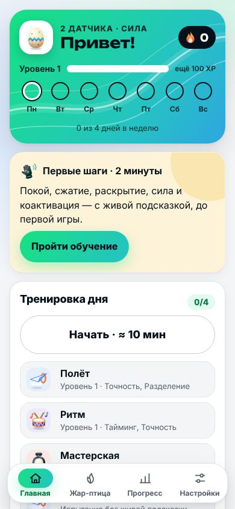
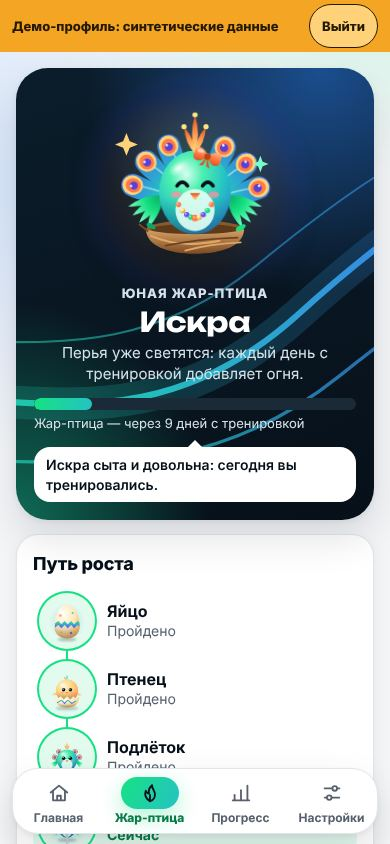
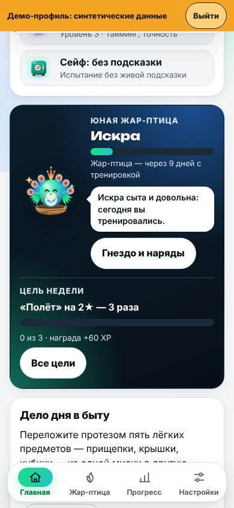
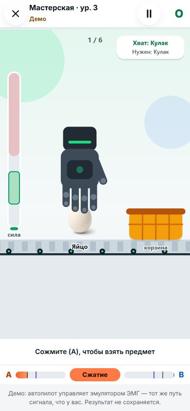
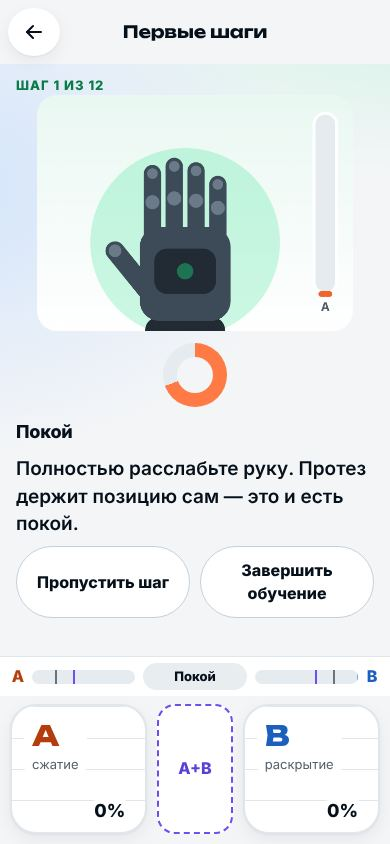
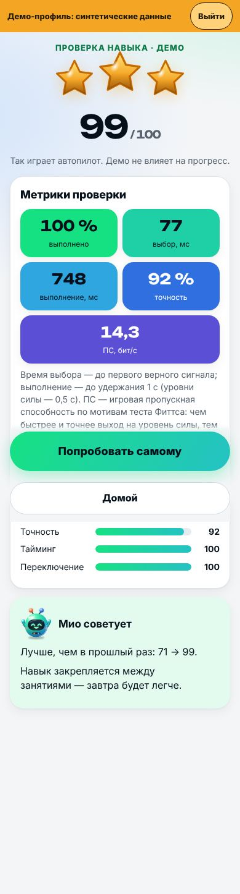
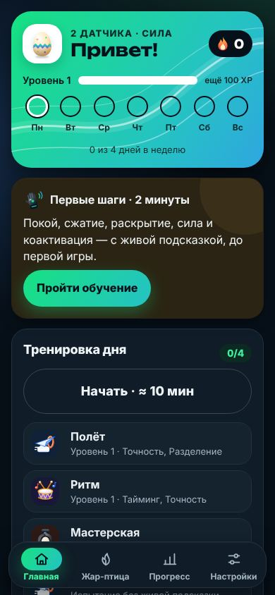

# Синергия — игра-тренажёр управления бионическим протезом

[](../../actions/workflows/ci.yml)   

Мобильная игра для людей с миоэлектрическими протезами кисти — и для тех, кто протез ещё ждёт. Короткие игры тренируют то, что протезу нужно каждый день: **взять предмет с нужной силой, удержать, отпустить, сменить хват, включиться вовремя** — во всех схемах задачи геймджема «Моторика: Код движения»: **две ЭМГ-кнопки (пороговый и пропорциональный режим)** и **7 жестов**.

<p>







</p>

## Запуск за 1 минуту

| Вариант | Как |
|---|---|
| **Android** | `release/Synergy-5.14.0.apk` (разрешить установку из неизвестных источников). Сборка подписана отладочным ключом машины, где её собрали: поверх APK с другой машины Android не установит (`INSTALL_FAILED_UPDATE_INCOMPATIBLE`). Тогда сначала «Настройки → Данные → Сохранить копию», удалить старое приложение, поставить новое и восстановить копию |
| **Любой браузер** | открыть `release/synergy-standalone.html` — один файл, без интернета |
| **PWA (GitHub Pages)** | включить Pages → Source: GitHub Actions; workflow `pages.yml` публикует `dist/` |
| **Разработка** | `npm start` → http://127.0.0.1:8080 (Node, работает и в Windows); с телефона в той же сети — `python3 tools/serve.py --lan` |

Датчики не нужны: встроенный **эмулятор ЭМГ** (площадки A/B — место касания = сила, A+B — коактивация, 7 кнопок жестов; клавиатура F/J/пробел/1–7). Для презентации: Настройки → «Данные» → «Демо-профиль для презентации».

## Что внутри

- **4 игры × 8 уровней × 3 схемы**: ✋ Мастерская (взять–перенести–отпустить, дозирование силы, смена хвата), 🕊️ Полёт (пропорциональная точность, разделение каналов), 🥁 Ритм (тайминг и уровни силы, процедурная музыка уровня — такт звучит, когда нота на линии (с учётом задержки вывода; на телефонах не проверено); для Bluetooth-наушников — «Синхронизация звука» в настройках), 🔐 Сейф (серия жестов/команд).
- **📋 Проверка навыка** — раз в неделю фиксированный набор заданий по мотивам Motion Test / TAC: доля выполненных, время выбора, время выполнения, точность; в пропорциональной схеме — **блок по мотивам теста Фиттса** и игровая пропускная способность в бит/с (сравнение только с собой прошлой недели).
- **Наука в механике (без обещаний эффекта):** тот же закон управления, что у протеза (перенос требует сходства задачи — Garske 2021); испытание **без подсказки** — игровая метрика удержания навыка (по мотивам тренировки с отсроченной обратной связью, Dupan 2025); **адаптивная сложность** (challenge point ≈ 75 %); **затухающие подсказки** по мере роста навыка; **интервальное повторение** в плане дня; коактивация **считается** по мотивам правила Maas 2024 (у них оба пика ≥ 40 % МПС за ≤ 350 мс; у нас ≥ 40 % комфортного уровня калибровки ≈ 28 % МПС, если комфортный уровень ≈ 70 % МПС: это самооценка, не измерение) — это способ подсчёта, а не доказательство пользы.
- **Безопасность:** опрос боли и усталости (с датчиками — и кожи под электродами) → обычный план / короткий план / отдых; признаки усталости; мягкий дневной лимит; отдых не прерывает серию; в онбординге — «после операции — с разрешения врача», «датчики только на здоровую кожу».
- **Для всех:** управление без касания (удержание мышцы), озвучивание, крупный текст (раскладка держит и системные 200 % Android), высокий контраст, «меньше движения», темп игр, вибро-метроном, зеркальная кисть, **любая ориентация экрана** (телефон в держателе коляски — альбомная раскладка с боковой навигацией), группы выбора со стрелками и именами для скринридера, **клавиатура и кнопочный переключатель** (пробел на площадке, F/J, стрелки и +/− — сила, Esc — назад), «Назад» ставит игру на паузу, упрощённая графика на слабых телефонах, **детский режим** с PIN родителя, **«Первые шаги»** — обучение с живой кистью.
- **Дизайн 5.12 «Моторика × ФинФениксы»:** макет — по образцу интерфейса ФинФениксов, цвета, шрифты (Unbounded, Inter — SIL OFL) и графика — по фирменному стилю «Моторики» (без логотипа и названия); светлая и тёмная темы и высокий контраст; тренер **Мио**, игры и награды — в «мягком 3D», нарисованы кодом в SVG. Контраст каждой пары цветов (≥ 4,5:1) проверяет тест — `docs/DESIGN.md`.
- **Жар-птица 5.13 — лучшие идеи образца ФинФениксов, без валюты и давления:** питомец растёт от дней с тренировкой, называет причину своего настроения (новая стадия, цель, план дня), отвечает на касание, носит **9 вещей за достижения** (кокошник, звезда во лбу, молодильные яблоки…) и предлагает **цели на неделю** по слабым навыкам — одна активная, без срока, награда ≤ плана дня. **Подсказки-туры** на главной и в «Прогрессе» показывают, с чего начать. Все правила и числа — `docs/GAME_RULES.md`, их сверяет с кодом тест.
- **5.14 — донор ФинФениксы «до дна» и боли клиентов «Моторики»:**
  - **Гнездо** — свой раздел Жар-птицы в нижней панели: аура пути до новой стадии, характер стадии, наряды, достижения и подарки с датами.
  - **Церемония роста** с пружинной анимацией; с «Меньше движения» — кроссфейд.
  - **«С возвращением»** без упрёка после перерыва.
  - **«Спросить Мио»** — ответы без интернета и без ИИ: ложные срабатывания, порог и чувствительность, боль, кожа, путь к протезу.
  - **«Дело дня в быту»** — перенос навыка в жизнь; режим **«Жду протез»**.
  - **Блокировка протеза** в «Первых шагах» — функция Motorica Start, удержание A+B со временем протеза пользователя.
  - **Встраивание в приложение заказчика** (`docs/INTEGRATION.md`).
  - **Отчёт за период** 7, 30 или 90 дней.
- **Для специалиста:** отчёт для печати/PDF, JSON, CSV: профиль навыков, проверки, ошибки жестов (и самая частая пара), самочувствие, результат испытания по позам руки (с датчиками); блок «Чем это проверяют в клинике» — игра тесты не заменяет.
- **Подключение:** WebSocket-мост, `postMessage`, `window.Synergy.feed()`, Android `pushFrame()`, **Bluetooth-датчики** (Nordic UART) + прошивка ESP32; лаборатория сырой ЭМГ → LDA 7 жестов. С реальными датчиками **покой подстраивается** под дрейф сигнала, при большом сдвиге игра просит перекалибровать.
- **Готово к 28.10:** набор 7 жестов (состав — гипотеза команды до публикации задачи) задан в **одном файле** (`src/core/vocabulary.js`), замена проверена учебным прогоном `npm run drill:gestures`; эмулятор ошибается как настоящий классификатор (похожие жесты путаются чаще).
- Офлайн, без аккаунта и аналитики; данные хранятся только на устройстве и уходят наружу только в файлах, которые вы сохраняете. **Не медицинское изделие.** Возрастная категория **0+** (436-ФЗ) — предложение, категорию подтверждает юрист команды (`docs/LEGAL.md` §3а).

## Проверка качества

```bash
npm ci && npm test              # 229 тестов: ядро, v5-модули, все игры × уровни × схемы (бот и модель новичка)
npm run build                   # dist/ (PWA) + dist/synergy-standalone.html
npm run drill:gestures          # учебная замена жеста: остальной код берёт набор из vocabulary.js
npm run e2e:a11y                 # мобильный e2e: 0 ошибок JS, axe-core — 0 нарушений на 23 состояниях экранов светлой темы и 9 тёмной (вкл. альбомную ориентацию и подсказки-туры)
npm run audit:layout             # линтер раскладки: 47 состояний × 7 размеров экрана × текст 100/130/200 % (987) — переполнения, наложения, цели < 44 px, фокус под панелями, просвет сквозь панели, площадки и главная кнопка на экране
VERIFY_API=1 sh tools/build-apk.sh   # APK + сверка Android-заглушек с настоящим API 29
```

e2e-скрипты сами поднимают локальный сервер (`tools/static-server.mjs`) — Python не нужен. Нужен Chromium для Playwright: `npm i --no-save playwright@1.56.1 && npx playwright install chromium`. **Windows:** `npm test` и сборка рассчитаны на PowerShell (задание `windows-latest` в CI ещё не запускалось — PLAN B.1), e2e на Windows не проверялись; APK и `npm run pack` — shell-скрипты (Git Bash или WSL). Распаковывайте архив целиком: без PNG-иконок тест `pwa: installable icons` падает и говорит об этом.

CI (`.github/workflows`, actions закреплены по SHA): тесты + учебная замена + сборка + e2e с аудитом доступности и линтером раскладки, dependency review на каждый PR; публикация PWA в Pages; релиз APK/HTML по тегу `v*` с SBOM (CycloneDX) и `SHA256SUMS`.

## Документы

| Файл | О чём |
|---|---|
| `docs/SCENARIOS.md` | все сценарии и граничные случаи → поведение → проверка |
| `docs/RESEARCH.md` | заказчик (в т. ч. VR-платформа Attilan), конкуренты, наука, интерфейсы 2026 |
| `docs/JURY_STRATEGY.md` · `docs/PITCH.md` | критерии, Murder Board, чек-лист сдачи · 10 слайдов, видео 90 с, демо 3 мин |
| `docs/GAME_RULES.md` | все правила и формулы игры с константами — сверяются с кодом тестом |
| `docs/GAME_DESIGN.md` · `docs/ARCHITECTURE.md` · `docs/INTEGRATION.md` | механики · слои и принципы · форматы и транспорты |
| `docs/AUDIT.md` | аудит 5.5–5.13 (§12 — что взято из образца ФинФениксов): триаж, Red Team, фактчекинг, конкуренты и SOTA, Murder Board, архитектура, логика, юзабилити |
| `docs/LEGAL.md` · `SECURITY.md` · `docs/ACCESSIBILITY.md` | право (п. 6.6, 152-ФЗ, 323-ФЗ) · модель угроз · доступность |
| `docs/AI_USAGE.md` · `AUTHORS.md` · `THIRD_PARTY.md` | раскрытие ИИ · авторы и РИД · компоненты третьих лиц |
| `MEMORY.md` · `PLAN.md` | состояние и план для новой сессии ИИ |

## Структура

```
src/core      домен: сигнал, протез, калибровка, прогресс, адаптация, самочувствие, обучение, аналитика
src/input     эмулятор ЭМГ, WebSocket/postMessage-мост, Bluetooth (NUS)
src/games     4 игры + проверка навыка, базовый класс, каталог, исполнитель шага
src/ui        экраны, площадки и клавиатура эмулятора · src/render графика · src/services звук, музыка, голос, вибрация, отчёты
android/      WebView-оболочка (TTS, «Поделиться», печать) · bridge/ мост и прошивка · lab/ DSP + LDA
tests/        node:test + Playwright · release/ готовые APK и HTML · legacy/v3 прошлая версия
```

© 2026 Команда SYNERGY. Все права защищены — см. `LICENSE` (п. 6.6 Правил хакатона).
