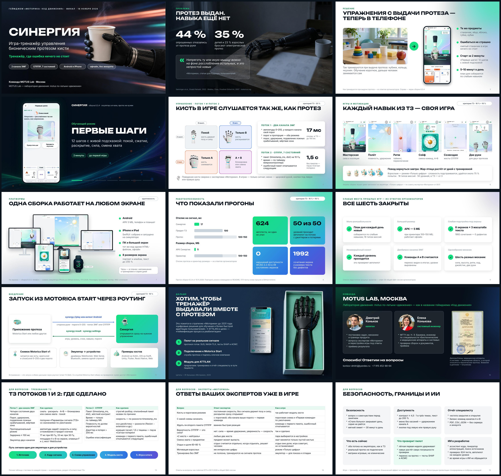

# Питч «Синергии» — финал «Моторика: Код движения», 18.11.2026

Команда MOTUS Lab — «лаборатория движения»: motus по-латыни «движение».

- **Играть в браузере:** https://konkovdv.github.io/Synergy/ — та же сборка 6.3.4 с `main`, после первого открытия работает офлайн.
- **Страница питча:** https://konkovdv.github.io/Synergy/pitch/ — ролик с главами, все слайды и приложения крупно, как закрыто ТЗ, цифры прогонов, удержание, план пилота и файлы. У каждого слайда свой адрес: `#slide-8` — слайд 8, `#appx-3` — страница 3 приложений; стрелки листают, F — во весь экран.
- **QR-коды** стоят на каждом слайде, в правом нижнем углу: «Питч-сайт» и «Демо игры». На слайде 12 они крупные. Оба читаются с проекции, даже если слайд на снимке телефона всего 1000 точек в ширину; в PowerPoint и PDF по ним можно щёлкнуть.

<p align="center"></p>

| Файл | Что это |
|---|---|
| [`Synergy-pitch-full.pdf`](Synergy-pitch-full.pdf), [`.pptx`](Synergy-pitch-full.pptx) | **вся презентация одним файлом**, 21 слайд: питч 1–12, оглавление приложений и П1–П8. В PDF карточки оглавления и строка разделов П1–П8 ведут на нужную страницу, QR-коды кликабельны |
| [`Synergy-pitch.pptx`](Synergy-pitch.pptx), [`.pdf`](Synergy-pitch.pdf) | версия на 15 слайдов — питч и приложения 1–3, если нужен лимит организаторов в 15 слайдов; в заметках PPTX — текст по секундам |
| [`Synergy-pitch-appendix.pptx`](Synergy-pitch-appendix.pptx), [`.pdf`](Synergy-pitch-appendix.pdf) | только приложения П1–П8: требования ТЗ, эксперты, безопасность, архитектура, проверки, отчёт специалисту, гипотезы пилота, ссылки |
| [`synergy-gameplay-reel.mp4`](synergy-gameplay-reel.mp4) | ролик геймплея, 42 с, 1080p: «Первые шаги» и шесть игр на эмуляторе; он же — первым экраном питч-сайта. В колоде ролика нет: в PDF видео не играет |
| [`SCRIPT.md`](SCRIPT.md) | что говорить на 4 минуты: 421 слово, речь заканчивается на 3:32; чек-лист, план на случай сбоев, версия на 3 минуты |
| [`slides.md`](slides.md) | текст всех 15 слайдов и откуда каждое утверждение |
| [`QA.md`](QA.md) | вопросы жюри с ответами по ролям, источник каждого утверждения и что мы убрали из колоды |
| [`index.html`](index.html), [`app.js`](app.js), [`web/`](web), [`sw.js`](sw.js) | страница питча на GitHub Pages; workflow `Pages (PWA)` кладёт её в `/pitch/` рядом с игрой |
| [`404.html`](404.html) | страница «Такой страницы нет» для всего сайта: ведёт в игру и на питч |
| [`fonts/`](fonts) | Unbounded и Inter — шрифты бренда «Моторики» и игры (SIL OFL 1.1) |

## Как показывать

Организаторы принимают презентацию в PDF. Одним файлом — `Synergy-pitch-full.pdf`: 21 слайд, питч и все приложения. Если нужен лимит в 15 слайдов — `Synergy-pitch.pdf`. Ролик геймплея открывается по QR-коду «Питч-сайт» на любом слайде.

1. Показ с PDF — во весь экран в любой программе просмотра. Шрифты встроены, ничего ставить не нужно.
2. Показ с PPTX — установить шрифты из `fonts/` (двойной щелчок по каждому файлу → «Установить») и открыть `Synergy-pitch-full.pptx` или `Synergy-pitch.pptx` в PowerPoint 2019 или Microsoft 365. Переходы — Morph; в старом PowerPoint и других программах вместо Morph будет затухание.
3. На вопросы жюри — приложения: в полной колоде это слайды 13–21 (13 — оглавление), в версии на 15 слайдов — колода `Synergy-pitch-appendix.pptx` во втором окне.

Что делать, если нет PowerPoint, нет сети или дали 3 минуты вместо 4, — в [`SCRIPT.md`](SCRIPT.md), раздел «Если что-то пошло не так».

## Как не разойтись в цифрах

Колоду, заметки, скрипт и текстовую копию правят по отдельности. Сверяет их одна команда:

```bash
npm run check:pitch
```

Что она проверяет:

- речь в заметках колоды совпадает с таблицей `SCRIPT.md` слово в слово;
- блоки идут подряд от 0:00 и укладываются в 4 минуты, темп не выше 140 слов в минуту, а заголовок скрипта называет настоящее число слов;
- цифры прогона (тесты, состояния axe, сочетания раскладки, APK) совпадают с `docs/evidence.json`;
- в текстах нет телефона и почты;
- слайдов не больше 15, у каждого есть раздел в `slides.md`;
- в файлах обеих колод нет путей с компьютера сборки, а телефон и почта есть только на слайде 12 основной;
- у каждого слайда есть картинка на сайте, и лишних нет; адреса картинок на странице свежие (`?v=` — хеш файла);
- размеры файлов, версия сборки и длина ролика на странице совпадают с настоящими.

Картинки слайдов для сайта, PDF обеих колод, `web/og.jpg` и `preview.jpg` делаются из самих колод одной командой (нужны LibreOffice и poppler):

```bash
python3 tools/pitch-export.py
```

Страницу целиком, как её отдаёт GitHub Pages, проверяет браузер: игра открывается, ошибок в консоли и битых картинок нет, от 320 до 2560 px ничего не уезжает вбок и ни одно слово не шире своего блока, просмотрщик слайдов, главы ролика и свой service worker работают, axe-core находит 0 нарушений, неизвестный адрес ведёт на 404.

```bash
npm run build && npm run check:pitch-page
```

CI запускает обе проверки на каждом пуше в `main`.

## Откуда материалы

- **Экраны игры** сняты из реальной сборки 6.3.4 в браузере: телефон 430 × 932, планшет, ноутбук, монитор и большой экран. В играх площадки нажимает встроенный демо-автопилот, в «Первых шагах» — скрипт.
- **iPhone**: 17.11.2026 приложение на SwiftUI собрано и запущено на симуляторе iPhone в GitHub Actions (workflow `iOS`); экран iPhone на слайде 7 — снимок оттуда.
- **Часы** на слайде 7 — концепт, и он так и подписан: приложения для часов нет.
- **Фотоиллюстрации** (обложка, «протез без дела», стол реабилитолога, протез в коробке, устройства на слайде 7) сгенерированы через Figma AI и отобраны командой. Ни одна не изображает реального человека или реальное изделие «Моторики». На экраны телефона в коробке и всех устройств на слайде 7 вставлены настоящие кадры сборки — так и подписано на слайде.
- **Цифры** — из прогона сборки 6.3.4 (`docs/evidence.json`). Ссылки на источники к каждому утверждению — в [`slides.md`](slides.md) и [`QA.md`](QA.md).
- **Иллюстрации игры** — из `public/art/`. Номер диплома на слайде команды размыт.
- **Контакты** команды есть только на слайде 12 колоды. На странице питча и в картинках слайдов для неё стоит копия колоды без строки с телефоном и почтой.
